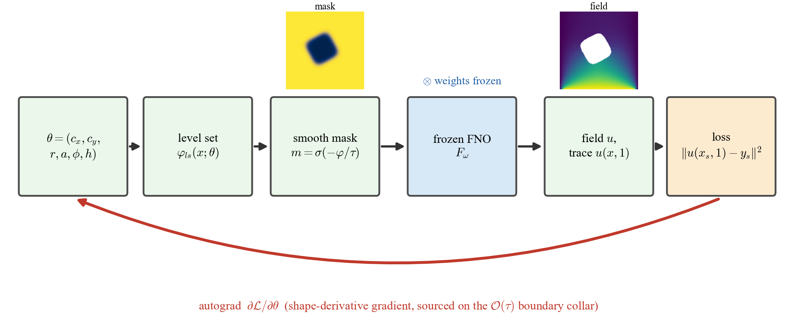

# DIVINO

**A Physics-Driven Differentiable Neural Operator for Geometric Inverse Heat Conduction**

Mohammad Taha Torbati · Mohsen Salimi · Majid Amidpour
K. N. Toosi University of Technology · Niroo Research Institute (NRI), Tehran, Iran

---

DIVINO (**Di**fferentiable **V**ariational **I**nverse **N**eural **O**perator) is a Fourier
neural operator for steady heat conduction in a plate that hides a super-elliptic cavity with a
convective (Robin) wall. It is trained **without solver labels**, by minimising the Deep-Ritz
energy of the PDE, and the cavity enters through a smooth level-set mask, so the operator is
**differentiable in the cavity geometry**. The same frozen network is therefore

1. a **forward surrogate** — 0.67 % relative L2 error in distribution and 0.77 % out of
   distribution against a body-fitted finite-element reference, on par with a faithful
   reimplementation of the variational operator VINO; and
2. the **forward map of a geometric inverse** — the cavity is recovered from sparse, noisy
   top-surface temperature by gradient descent through the frozen operator, with no online PDE
   solve and no hand-derived adjoint. Over ten random geometries this reproduces the per-parameter
   errors of a Gauss–Newton inversion run through the finite-element model itself, at 3.7× lower
   cost per reconstruction.

A Fisher-information analysis, checked against finite-element inversions, shows that top-surface
temperature reveals the cavity size and lateral position, that depth trades off against size, and
that the shape exponent and orientation are effectively unrecoverable, because diffusion attenuates
the angular harmonics that carry them.

<p align="center">
  
</p>

## Repository layout

```
DIVINO/
├── src/                        Library and command-line pipeline
│   ├── divino.py                 operator (FNO), differentiable super-ellipse geometry,
│   │                             Deep-Ritz energy (source + Robin, perimeter-corrected), grid solver
│   ├── fem.py                    body-fitted P1 finite-element reference (scikit-fem)
│   ├── train.py                  label-free energy training of the operator
│   ├── benchmark_forward.py      forward accuracy against the finite-element reference
│   ├── baselines.py              strong-form, data-driven, and per-geometry PINN baselines; timing
│   ├── inverse_study.py          geometric inverse, noise study, Fisher information, sensor design
│   ├── insulation_fidelity.py    cavity heat-flux balance (natural boundary condition check)
│   ├── ablation.py               grid / modes / width / seed ablation
│   ├── make_figures.py           field-comparison figures
│   ├── validate_physics.py       grid Deep-Ritz minimiser against finite elements (physics check)
│   ├── configs/config.yaml       all settings (reduced-scale defaults, full-scale notes)
│   ├── checkpoints/              trained operator weights (created by train.py)
│   └── run_all.sh                one-command reproduction of the pipeline
├── notebooks/
│   ├── DIVINO_main_study.ipynb         every main-text figure and table
│   └── DIVINO_robustness_studies.ipynb smoothing length, multi-start, correlated noise,
│                                       out-of-distribution shapes, two-cavity proximity, cost
├── results/
│   ├── figures/                  all figures (vector PDF and 300-dpi PNG)
│   ├── tables/                   all tables (CSV)
│   └── fim.npy                   Fisher information matrix at the nominal geometry
├── requirements.txt
├── CITATION.cff
└── LICENSE
```

## Installation

Python 3.10 or newer. A CUDA GPU is recommended for training and inversion; the finite-element
reference runs on the CPU.

```bash
git clone https://github.com/mtahator/DIVINO.git
cd DIVINO
pip install -r requirements.txt
```

`scikit-fem` may print a harmless `Transforming over N vertices to C_CONTIGUOUS` diagnostic on some
builds.

## Reproducing the results

**1. Check the physics** (grid Deep-Ritz minimiser against body-fitted finite elements):

```bash
cd src
python validate_physics.py
```

**2. Train the operator** (one GPU, reduced-scale configuration of the paper):

```bash
python train.py --N 128 --steps 9000 --out checkpoints/pino.pt
```

**3. Run the pipeline** (forward benchmark, baselines, inverse study, boundary fidelity, ablation):

```bash
./run_all.sh            # set PY=/path/to/python to choose the interpreter
```

Every stage accepts command-line overrides (`--N`, `--steps`, sample and seed counts), so it can be
smoke-tested at a tiny scale before a full run, for example
`python train.py --N 32 --steps 20 --out checkpoints/smoke.pt`.

**4. Notebooks.** Run both notebooks from the `notebooks/` directory after step 2; they import the
library from `../src`, load `../src/checkpoints/pino.pt`, and write to `../results/`. Their outputs
are embedded, so the full study can be read without re-running it. Problem sizes are controlled by
environment variables (`STEPS`, `N_FWD`, `N_OOD`, `INV_REPS`, `SEEDS`, ...) read in the first code
cell.

## Results

All numbers in the paper are taken from the CSV files in `results/tables/`.

| Paper content | Tables |
|---|---|
| Forward accuracy (in and out of distribution, by cavity count) | `T1_forward_accuracy`, `T1b_forward_ood_clamped`, `M1_forward_by_count`, `forward_metrics` |
| Baselines, tuned residual baseline, parity with VINO | `T2_baselines`, `T_tuned_residual_lr_sweep`, `T_parity` |
| Conditioning, boundary fidelity, Robin convergence, perimeter correction | `T_conditioning`, `T_insulation`, `T_robin_convergence`, `T_cutcell_perimeter_convergence` |
| Mesh convergence, ablation, out-of-distribution shapes | `T_mesh_convergence`, `T3_ablation`, `T_ood_star_triangle` |
| Cost | `T_speedup`, `T_cost_summary`, `T_adjoint_fem_break_even` |
| Recovery at the nominal geometry, multi-start, smoothing length | `T4_inverse_recovery`, `T_local_minima_multistart`, `T_tau_sensitivity` |
| Surrogate against finite-element (Gauss–Newton) inversion | `T_fem_vs_divino_inverse`, `T_fem_vs_divino_summary`, `T_fem_coldstart_inverse`, `T_fem_gn_convergence`, `T_equivalence_clustered` |
| Error decomposition, gradient validation, finite-difference step | `T_error_decomposition`, `T_gradient_validation`, `T_fd_step_check` |
| Regularisation and prior sensitivity | `T_regularisation_sweep`, `T_prior_centre_shift` |
| Fisher information, depth, sensor design, finite-element Fisher check | `T_fim`, `T_ident_depth`, `T_sensor_information`, `T_fisher_fem_check`, `T_fisher_depth_fem` |
| Noise and correlated noise, two-cavity proximity | `T_noise`, `T_correlated_noise`, `T_two_hole_proximity` |

## Method in brief

The discrete Deep-Ritz energy `½∫|∇u|² − ∫Qu + ½∮h(u−u∞)²` has the stiffness matrix `K` as its
Hessian, whereas a strong-form residual loss has Hessian `KᵀK`; its condition number is the square of
the energy's, which is why label-free energy training reaches sub-percent error while residual
training stalls. Insulated and convective walls are natural boundary conditions of the energy and need
no penalty weight; Dirichlet data are imposed exactly. The cavity is a rotated super-ellipse
`|X|ᵃ + |Y|ᵃ = rᵃ` encoded as a signed level set and a sigmoid mask, which makes the operator
differentiable in `θ = (cₓ, c_y, r, a, φ, h)` and turns the geometric inverse into gradient descent
through the frozen network. The Fisher information `I = σ⁻² JᵀJ` of the top-surface readings, computed
from the same Jacobian, quantifies which parameters the data can reveal.

## Citation

If you use this code or its results, please cite:

```bibtex
@article{Torbati_DIVINO,
  author = {Torbati, Mohammad Taha and Salimi, Mohsen and Amidpour, Majid},
  title  = {{DIVINO}: A Physics-Driven Differentiable Neural Operator for Geometric Inverse Heat Conduction},
  note   = {Manuscript submitted for publication},
  year   = {2026}
}
```

## License

Released under the [MIT License](LICENSE).
